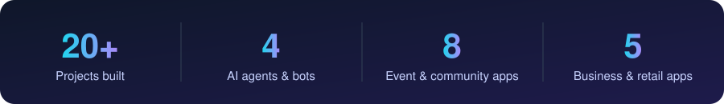

  

# Hi, I'm Paresh 👋

I build practical AI tools and cloud apps for small businesses and community organizations, through my company **Storelyft LLC**.

I focus on real problems: less manual work, more customers, and tools that non-technical people can use on day one.

  

## What I've built

| Type | What it does | Built with |
|---|---|---|
| 🤖 **AI agents & bots** | Two Telegram build bots: people ask for a change in plain English, AI builds it, sends screenshots of a test site, and goes live only after approval. Plus a paper-trading agent and an MCP server with 18 contact-center analytics tools. | Claude · MCP · Telegram |
| 🛒 **Retail & e-commerce** | Retail operations SaaS for store teams (shifts, stock, daily ops). A custom fine-jewelry store. An AI kit for redesigning and growing Shopify stores. | React · Next.js · Shopify · AWS |
| 🎪 **Event & community apps** | Event portals with role-based access, a delegate app with targeted push notifications, live survey + word-cloud dashboards, guest info pages, volunteer project tools, and a live cue monitor for a museum opening. | React PWA · AWS serverless |
| ✈️ **Consumer apps** | A group-trip planning app for families, and a personal finance tracker with bank sync. | React · AWS · Plaid |
| 📊 **Dashboards & analytics** | Meeting attendance and engagement analytics from Microsoft Teams exports. | Web app · charts |
| 📚 **Team & content tools** | A shared workspace for a team translating a book from Gujarati to English, plus a self-hosted, low-cost photo server and personal website. | GitHub · AWS S3 · CloudFront |

## How I work

- Start with one real task the owner wants solved
- Build small, test on a staging site, go live only after approval
- Keep costs low and data secure (AWS serverless, least-privilege access)
- Teach the team so they can run it themselves

## Tools

AI: OpenAI · Claude · MCP · AI agents and automation
Cloud: AWS (Lambda, API Gateway, DynamoDB, S3, CloudFront, Cognito)
Web: React · Node.js · Python · Shopify · PWAs

## Contact

Most of my client and community work is in private repositories. Happy to give a walkthrough or demo.
